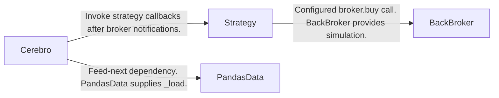
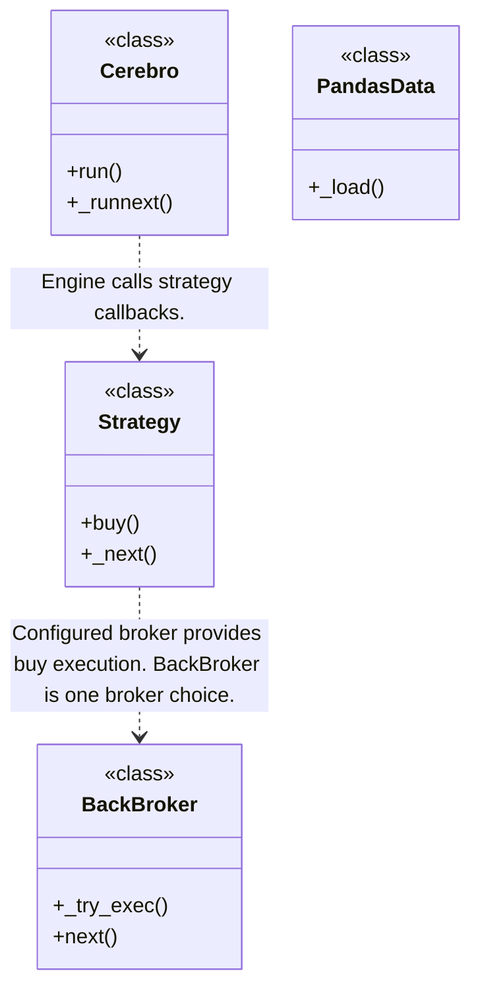
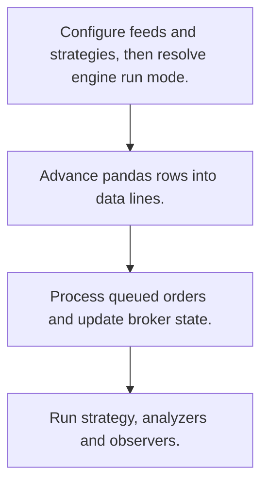
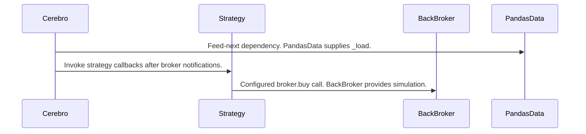

# Backtrader: workflow, design and architecture

Updated: **2026-10-13**
Reviewed Git hash: `fb7df7f35d6fd75c5f992bc60710da17bb471f7e`
Branch: `feature/ayu_develop`
Source diff SHA256: `e3b0c44298fc1c149afbf4c8996fb92427ae41e4649b934ca495991b7852b855`
Scope: **Event-driven trading engine** / Maintenance: **active**
Languages: Python

[HTML edition](ayu-develop.html) / [Development](development.md) / [Historical validation](validation.md) / [Full system comparison](../../docs/index.html)

## Purpose and scope

Coordinate feeds, strategies, simulated broker execution and broker/store integrations.

## Features and support boundaries

Native = implemented here. Integration = supplied through a named host/API. Limited = material restriction. Not provided = evidenced scope exclusion. Unverified = support/absence not established. Not applicable = outside this artifact type.

| Capability | Status | Implementation and limits | Source |
|---|---|---|---|
| Backtesting | Native | Cerebro synchronizes feeds and advances a simulated broker. | [Cerebro.run](../src/backtrader/cerebro.py) ([L1030](https://github.com/alexcwyu/backtrader/blob/fb7df7f35d6fd75c5f992bc60710da17bb471f7e/src/backtrader/cerebro.py#L1030)) / [Cerebro._runnext](../src/backtrader/cerebro.py) ([L1498](https://github.com/alexcwyu/backtrader/blob/fb7df7f35d6fd75c5f992bc60710da17bb471f7e/src/backtrader/cerebro.py#L1498)) / [BackBroker._try_exec](../src/backtrader/brokers/bbroker.py) ([L1040](https://github.com/alexcwyu/backtrader/blob/fb7df7f35d6fd75c5f992bc60710da17bb471f7e/src/backtrader/brokers/bbroker.py#L1040)) / [BackBroker.next](../src/backtrader/brokers/bbroker.py) ([L1176](https://github.com/alexcwyu/backtrader/blob/fb7df7f35d6fd75c5f992bc60710da17bb471f7e/src/backtrader/brokers/bbroker.py#L1176)) |
| Live execution | Integration | Live mode disables preload/runonce and routes Strategy.buy to the configured broker. Actual external broker availability is not validated. | [Cerebro.run](../src/backtrader/cerebro.py) ([L1030](https://github.com/alexcwyu/backtrader/blob/fb7df7f35d6fd75c5f992bc60710da17bb471f7e/src/backtrader/cerebro.py#L1030)) / [Cerebro._runnext](../src/backtrader/cerebro.py) ([L1498](https://github.com/alexcwyu/backtrader/blob/fb7df7f35d6fd75c5f992bc60710da17bb471f7e/src/backtrader/cerebro.py#L1498)) / [Strategy.buy](../src/backtrader/strategy.py) ([L774](https://github.com/alexcwyu/backtrader/blob/fb7df7f35d6fd75c5f992bc60710da17bb471f7e/src/backtrader/strategy.py#L774)) / [Strategy._next](../src/backtrader/strategy.py) ([L346](https://github.com/alexcwyu/backtrader/blob/fb7df7f35d6fd75c5f992bc60710da17bb471f7e/src/backtrader/strategy.py#L346)) |
| Paper trading | Limited | BackBroker simulates fills. Standalone live paper connectivity was not inspected. | [BackBroker._try_exec](../src/backtrader/brokers/bbroker.py) ([L1040](https://github.com/alexcwyu/backtrader/blob/fb7df7f35d6fd75c5f992bc60710da17bb471f7e/src/backtrader/brokers/bbroker.py#L1040)) / [BackBroker.next](../src/backtrader/brokers/bbroker.py) ([L1176](https://github.com/alexcwyu/backtrader/blob/fb7df7f35d6fd75c5f992bc60710da17bb471f7e/src/backtrader/brokers/bbroker.py#L1176)) |
| Event driven | Native | Per-feed advancement and strategy callbacks with broker/data notifications. | [Cerebro.run](../src/backtrader/cerebro.py) ([L1030](https://github.com/alexcwyu/backtrader/blob/fb7df7f35d6fd75c5f992bc60710da17bb471f7e/src/backtrader/cerebro.py#L1030)) / [Cerebro._runnext](../src/backtrader/cerebro.py) ([L1498](https://github.com/alexcwyu/backtrader/blob/fb7df7f35d6fd75c5f992bc60710da17bb471f7e/src/backtrader/cerebro.py#L1498)) |
| Vectorized | Limited | runonce can precompute indicators, but feed synchronization and order execution remain stateful. | [Cerebro.run](../src/backtrader/cerebro.py) ([L1030](https://github.com/alexcwyu/backtrader/blob/fb7df7f35d6fd75c5f992bc60710da17bb471f7e/src/backtrader/cerebro.py#L1030)) / [Cerebro._runnext](../src/backtrader/cerebro.py) ([L1498](https://github.com/alexcwyu/backtrader/blob/fb7df7f35d6fd75c5f992bc60710da17bb471f7e/src/backtrader/cerebro.py#L1498)) |
| Order management | Native | Submitted/pending queues and broker notifications. | [BackBroker._try_exec](../src/backtrader/brokers/bbroker.py) ([L1040](https://github.com/alexcwyu/backtrader/blob/fb7df7f35d6fd75c5f992bc60710da17bb471f7e/src/backtrader/brokers/bbroker.py#L1040)) / [BackBroker.next](../src/backtrader/brokers/bbroker.py) ([L1176](https://github.com/alexcwyu/backtrader/blob/fb7df7f35d6fd75c5f992bc60710da17bb471f7e/src/backtrader/brokers/bbroker.py#L1176)) |
| Order types | Native | Market, close, limit, stop, stop-limit and trailing execution branches. | [BackBroker._try_exec](../src/backtrader/brokers/bbroker.py) ([L1040](https://github.com/alexcwyu/backtrader/blob/fb7df7f35d6fd75c5f992bc60710da17bb471f7e/src/backtrader/brokers/bbroker.py#L1040)) / [BackBroker.next](../src/backtrader/brokers/bbroker.py) ([L1176](https://github.com/alexcwyu/backtrader/blob/fb7df7f35d6fd75c5f992bc60710da17bb471f7e/src/backtrader/brokers/bbroker.py#L1176)) |
| Multi venue | Unverified | The inspected source does not establish this capability. This is not a claim of absence. | Not applicable to this repository scope. |
| Crypto | Unverified | The inspected source does not establish this capability. This is not a claim of absence. | Not applicable to this repository scope. |
| Equities | Unverified | The inspected source does not establish this capability. This is not a claim of absence. | Not applicable to this repository scope. |
| Futures | Unverified | The inspected source does not establish this capability. This is not a claim of absence. | Not applicable to this repository scope. |
| Options | Unverified | The inspected source does not establish this capability. This is not a claim of absence. | Not applicable to this repository scope. |
| Forex | Unverified | The inspected source does not establish this capability. This is not a claim of absence. | Not applicable to this repository scope. |
| Strategy api | Native | Strategy line-iterator callbacks and broker buy method. | [Strategy.buy](../src/backtrader/strategy.py) ([L774](https://github.com/alexcwyu/backtrader/blob/fb7df7f35d6fd75c5f992bc60710da17bb471f7e/src/backtrader/strategy.py#L774)) / [Strategy._next](../src/backtrader/strategy.py) ([L346](https://github.com/alexcwyu/backtrader/blob/fb7df7f35d6fd75c5f992bc60710da17bb471f7e/src/backtrader/strategy.py#L346)) |
| Optimization | Native | Cerebro runs parameter combinations and may distribute optimization across local worker processes. | [Cerebro.run](../src/backtrader/cerebro.py) ([L1030](https://github.com/alexcwyu/backtrader/blob/fb7df7f35d6fd75c5f992bc60710da17bb471f7e/src/backtrader/cerebro.py#L1030)) / [Cerebro._runnext](../src/backtrader/cerebro.py) ([L1498](https://github.com/alexcwyu/backtrader/blob/fb7df7f35d6fd75c5f992bc60710da17bb471f7e/src/backtrader/cerebro.py#L1498)) |
| Machine learning | Unverified | The inspected source does not establish this capability. This is not a claim of absence. | Not applicable to this repository scope. |
| Reinforcement learning | Unverified | The inspected source does not establish this capability. This is not a claim of absence. | Not applicable to this repository scope. |
| Portfolio | Native | Broker cash, positions, credit interest and valuation. | [BackBroker._try_exec](../src/backtrader/brokers/bbroker.py) ([L1040](https://github.com/alexcwyu/backtrader/blob/fb7df7f35d6fd75c5f992bc60710da17bb471f7e/src/backtrader/brokers/bbroker.py#L1040)) / [BackBroker.next](../src/backtrader/brokers/bbroker.py) ([L1176](https://github.com/alexcwyu/backtrader/blob/fb7df7f35d6fd75c5f992bc60710da17bb471f7e/src/backtrader/brokers/bbroker.py#L1176)) |
| Risk management | Unverified | The inspected source does not establish this capability. This is not a claim of absence. | Not applicable to this repository scope. |
| Performance analytics | Native | Strategy invokes configured analyzers and observers after its callback. | [Strategy.buy](../src/backtrader/strategy.py) ([L774](https://github.com/alexcwyu/backtrader/blob/fb7df7f35d6fd75c5f992bc60710da17bb471f7e/src/backtrader/strategy.py#L774)) / [Strategy._next](../src/backtrader/strategy.py) ([L346](https://github.com/alexcwyu/backtrader/blob/fb7df7f35d6fd75c5f992bc60710da17bb471f7e/src/backtrader/strategy.py#L346)) |
| Historical data | Native | PandasData loads chronological rows into engine line buffers. | [PandasData._load](../src/backtrader/feeds/pandafeed.py) ([L234](https://github.com/alexcwyu/backtrader/blob/fb7df7f35d6fd75c5f992bc60710da17bb471f7e/src/backtrader/feeds/pandafeed.py#L234)) |
| Streaming data | Integration | Feed loop handles live-data availability. Exchange/store endpoints were not validated. | [Cerebro.run](../src/backtrader/cerebro.py) ([L1030](https://github.com/alexcwyu/backtrader/blob/fb7df7f35d6fd75c5f992bc60710da17bb471f7e/src/backtrader/cerebro.py#L1030)) / [Cerebro._runnext](../src/backtrader/cerebro.py) ([L1498](https://github.com/alexcwyu/backtrader/blob/fb7df7f35d6fd75c5f992bc60710da17bb471f7e/src/backtrader/cerebro.py#L1498)) |
| Persistence | Unverified | The inspected source does not establish this capability. This is not a claim of absence. | Not applicable to this repository scope. |
| Data pipeline | Unverified | The inspected source does not establish this capability. This is not a claim of absence. | Not applicable to this repository scope. |
| Web ui | Unverified | The inspected source does not establish this capability. This is not a claim of absence. | Not applicable to this repository scope. |
| Cli | Unverified | The inspected source does not establish this capability. This is not a claim of absence. | Not applicable to this repository scope. |
| Monitoring | Unverified | The inspected source does not establish this capability. This is not a claim of absence. | Not applicable to this repository scope. |
| Extension api | Native | Replace feeds, strategies, analyzers, observers and broker. | [Cerebro.run](../src/backtrader/cerebro.py) ([L1030](https://github.com/alexcwyu/backtrader/blob/fb7df7f35d6fd75c5f992bc60710da17bb471f7e/src/backtrader/cerebro.py#L1030)) / [Cerebro._runnext](../src/backtrader/cerebro.py) ([L1498](https://github.com/alexcwyu/backtrader/blob/fb7df7f35d6fd75c5f992bc60710da17bb471f7e/src/backtrader/cerebro.py#L1498)) / [Strategy.buy](../src/backtrader/strategy.py) ([L774](https://github.com/alexcwyu/backtrader/blob/fb7df7f35d6fd75c5f992bc60710da17bb471f7e/src/backtrader/strategy.py#L774)) / [Strategy._next](../src/backtrader/strategy.py) ([L346](https://github.com/alexcwyu/backtrader/blob/fb7df7f35d6fd75c5f992bc60710da17bb471f7e/src/backtrader/strategy.py#L346)) |
| Native acceleration | Unverified | The inspected runtime uses Python line buffers and optional multiprocessing. No native acceleration claim is established. | [Cerebro.run](../src/backtrader/cerebro.py) ([L1030](https://github.com/alexcwyu/backtrader/blob/fb7df7f35d6fd75c5f992bc60710da17bb471f7e/src/backtrader/cerebro.py#L1030)) / [Cerebro._runnext](../src/backtrader/cerebro.py) ([L1498](https://github.com/alexcwyu/backtrader/blob/fb7df7f35d6fd75c5f992bc60710da17bb471f7e/src/backtrader/cerebro.py#L1498)) |
| Distributed execution | Unverified | The inspected source does not establish this capability. This is not a claim of absence. | Not applicable to this repository scope. |

## System components

| Component | Responsibility | Source |
|---|---|---|
| Cerebro | Feed synchronization and engine lifecycle. | [Cerebro.run](../src/backtrader/cerebro.py) ([L1030](https://github.com/alexcwyu/backtrader/blob/fb7df7f35d6fd75c5f992bc60710da17bb471f7e/src/backtrader/cerebro.py#L1030)) / [Cerebro._runnext](../src/backtrader/cerebro.py) ([L1498](https://github.com/alexcwyu/backtrader/blob/fb7df7f35d6fd75c5f992bc60710da17bb471f7e/src/backtrader/cerebro.py#L1498)) |
| Strategy | User strategy, sizing and notifications. | [Strategy.buy](../src/backtrader/strategy.py) ([L774](https://github.com/alexcwyu/backtrader/blob/fb7df7f35d6fd75c5f992bc60710da17bb471f7e/src/backtrader/strategy.py#L774)) / [Strategy._next](../src/backtrader/strategy.py) ([L346](https://github.com/alexcwyu/backtrader/blob/fb7df7f35d6fd75c5f992bc60710da17bb471f7e/src/backtrader/strategy.py#L346)) |
| BackBroker | Native simulated broker and execution policies. | [BackBroker._try_exec](../src/backtrader/brokers/bbroker.py) ([L1040](https://github.com/alexcwyu/backtrader/blob/fb7df7f35d6fd75c5f992bc60710da17bb471f7e/src/backtrader/brokers/bbroker.py#L1040)) / [BackBroker.next](../src/backtrader/brokers/bbroker.py) ([L1176](https://github.com/alexcwyu/backtrader/blob/fb7df7f35d6fd75c5f992bc60710da17bb471f7e/src/backtrader/brokers/bbroker.py#L1176)) |
| PandasData | Historical pandas adapter. | [PandasData._load](../src/backtrader/feeds/pandafeed.py) ([L234](https://github.com/alexcwyu/backtrader/blob/fb7df7f35d6fd75c5f992bc60710da17bb471f7e/src/backtrader/feeds/pandafeed.py#L234)) |

## Architecture and component boundaries

The component view summarizes inspected responsibility boundaries. Arrows identify the documented API/data dependencies; this is not a deployment-readiness claim.

- Feed-next dependency. PandasData supplies _load.: [Cerebro.run](../src/backtrader/cerebro.py) ([L1030](https://github.com/alexcwyu/backtrader/blob/fb7df7f35d6fd75c5f992bc60710da17bb471f7e/src/backtrader/cerebro.py#L1030)) / [Cerebro._runnext](../src/backtrader/cerebro.py) ([L1498](https://github.com/alexcwyu/backtrader/blob/fb7df7f35d6fd75c5f992bc60710da17bb471f7e/src/backtrader/cerebro.py#L1498)) / [PandasData._load](../src/backtrader/feeds/pandafeed.py) ([L234](https://github.com/alexcwyu/backtrader/blob/fb7df7f35d6fd75c5f992bc60710da17bb471f7e/src/backtrader/feeds/pandafeed.py#L234))
- Invoke strategy callbacks after broker notifications.: [Cerebro.run](../src/backtrader/cerebro.py) ([L1030](https://github.com/alexcwyu/backtrader/blob/fb7df7f35d6fd75c5f992bc60710da17bb471f7e/src/backtrader/cerebro.py#L1030)) / [Cerebro._runnext](../src/backtrader/cerebro.py) ([L1498](https://github.com/alexcwyu/backtrader/blob/fb7df7f35d6fd75c5f992bc60710da17bb471f7e/src/backtrader/cerebro.py#L1498))
- Configured broker.buy call. BackBroker provides simulation.: [Strategy.buy](../src/backtrader/strategy.py) ([L774](https://github.com/alexcwyu/backtrader/blob/fb7df7f35d6fd75c5f992bc60710da17bb471f7e/src/backtrader/strategy.py#L774)) / [Strategy._next](../src/backtrader/strategy.py) ([L346](https://github.com/alexcwyu/backtrader/blob/fb7df7f35d6fd75c5f992bc60710da17bb471f7e/src/backtrader/strategy.py#L346))

## Design decisions

| Decision | Rationale | Tradeoff | Evidence |
|---|---|---|---|
| Use line buffers and synchronized feed datetimes. | Multiple feeds and indicators share a staged callback lifecycle. | Preload/runonce are disabled for live or replay modes. | [Cerebro.run](../src/backtrader/cerebro.py) ([L1030](https://github.com/alexcwyu/backtrader/blob/fb7df7f35d6fd75c5f992bc60710da17bb471f7e/src/backtrader/cerebro.py#L1030)) / [Cerebro._runnext](../src/backtrader/cerebro.py) ([L1498](https://github.com/alexcwyu/backtrader/blob/fb7df7f35d6fd75c5f992bc60710da17bb471f7e/src/backtrader/cerebro.py#L1498)) |

## Class and interface relationships

Each node is a reviewed source symbol. Function/module nodes are explicitly labeled; they do not imply Python classes. Only reviewed relationships are drawn.

- **Cerebro** (class): [Cerebro.run](../src/backtrader/cerebro.py) ([L1030](https://github.com/alexcwyu/backtrader/blob/fb7df7f35d6fd75c5f992bc60710da17bb471f7e/src/backtrader/cerebro.py#L1030)) / [Cerebro._runnext](../src/backtrader/cerebro.py) ([L1498](https://github.com/alexcwyu/backtrader/blob/fb7df7f35d6fd75c5f992bc60710da17bb471f7e/src/backtrader/cerebro.py#L1498))
- **Strategy** (class): [Strategy.buy](../src/backtrader/strategy.py) ([L774](https://github.com/alexcwyu/backtrader/blob/fb7df7f35d6fd75c5f992bc60710da17bb471f7e/src/backtrader/strategy.py#L774)) / [Strategy._next](../src/backtrader/strategy.py) ([L346](https://github.com/alexcwyu/backtrader/blob/fb7df7f35d6fd75c5f992bc60710da17bb471f7e/src/backtrader/strategy.py#L346))
- **BackBroker** (class): [BackBroker._try_exec](../src/backtrader/brokers/bbroker.py) ([L1040](https://github.com/alexcwyu/backtrader/blob/fb7df7f35d6fd75c5f992bc60710da17bb471f7e/src/backtrader/brokers/bbroker.py#L1040)) / [BackBroker.next](../src/backtrader/brokers/bbroker.py) ([L1176](https://github.com/alexcwyu/backtrader/blob/fb7df7f35d6fd75c5f992bc60710da17bb471f7e/src/backtrader/brokers/bbroker.py#L1176))
- **PandasData** (class): [PandasData._load](../src/backtrader/feeds/pandafeed.py) ([L234](https://github.com/alexcwyu/backtrader/blob/fb7df7f35d6fd75c5f992bc60710da17bb471f7e/src/backtrader/feeds/pandafeed.py#L234))

## Workflow

### Representative source-backed flow

The steps describe the inspected implementation. User configuration and data inputs are external prerequisites.

1. Configure feeds and strategies, then resolve engine run mode.. [Cerebro.run](../src/backtrader/cerebro.py) ([L1030](https://github.com/alexcwyu/backtrader/blob/fb7df7f35d6fd75c5f992bc60710da17bb471f7e/src/backtrader/cerebro.py#L1030)) / [Cerebro._runnext](../src/backtrader/cerebro.py) ([L1498](https://github.com/alexcwyu/backtrader/blob/fb7df7f35d6fd75c5f992bc60710da17bb471f7e/src/backtrader/cerebro.py#L1498))
2. Advance pandas rows into data lines.. [PandasData._load](../src/backtrader/feeds/pandafeed.py) ([L234](https://github.com/alexcwyu/backtrader/blob/fb7df7f35d6fd75c5f992bc60710da17bb471f7e/src/backtrader/feeds/pandafeed.py#L234))
3. Process queued orders and update broker state.. [Cerebro.run](../src/backtrader/cerebro.py) ([L1030](https://github.com/alexcwyu/backtrader/blob/fb7df7f35d6fd75c5f992bc60710da17bb471f7e/src/backtrader/cerebro.py#L1030)) / [Cerebro._runnext](../src/backtrader/cerebro.py) ([L1498](https://github.com/alexcwyu/backtrader/blob/fb7df7f35d6fd75c5f992bc60710da17bb471f7e/src/backtrader/cerebro.py#L1498)) / [BackBroker._try_exec](../src/backtrader/brokers/bbroker.py) ([L1040](https://github.com/alexcwyu/backtrader/blob/fb7df7f35d6fd75c5f992bc60710da17bb471f7e/src/backtrader/brokers/bbroker.py#L1040)) / [BackBroker.next](../src/backtrader/brokers/bbroker.py) ([L1176](https://github.com/alexcwyu/backtrader/blob/fb7df7f35d6fd75c5f992bc60710da17bb471f7e/src/backtrader/brokers/bbroker.py#L1176))
4. Run strategy, analyzers and observers.. [Cerebro.run](../src/backtrader/cerebro.py) ([L1030](https://github.com/alexcwyu/backtrader/blob/fb7df7f35d6fd75c5f992bc60710da17bb471f7e/src/backtrader/cerebro.py#L1030)) / [Cerebro._runnext](../src/backtrader/cerebro.py) ([L1498](https://github.com/alexcwyu/backtrader/blob/fb7df7f35d6fd75c5f992bc60710da17bb471f7e/src/backtrader/cerebro.py#L1498)) / [Strategy.buy](../src/backtrader/strategy.py) ([L774](https://github.com/alexcwyu/backtrader/blob/fb7df7f35d6fd75c5f992bc60710da17bb471f7e/src/backtrader/strategy.py#L774)) / [Strategy._next](../src/backtrader/strategy.py) ([L346](https://github.com/alexcwyu/backtrader/blob/fb7df7f35d6fd75c5f992bc60710da17bb471f7e/src/backtrader/strategy.py#L346))

## Sequence

Representative calls and data dependencies

Messages represent inspected calls or explicitly labelled data dependencies. A data dependency is not an asserted direct runtime call.

- Feed-next dependency. PandasData supplies _load.: [Cerebro.run](../src/backtrader/cerebro.py) ([L1030](https://github.com/alexcwyu/backtrader/blob/fb7df7f35d6fd75c5f992bc60710da17bb471f7e/src/backtrader/cerebro.py#L1030)) / [Cerebro._runnext](../src/backtrader/cerebro.py) ([L1498](https://github.com/alexcwyu/backtrader/blob/fb7df7f35d6fd75c5f992bc60710da17bb471f7e/src/backtrader/cerebro.py#L1498)) / [PandasData._load](../src/backtrader/feeds/pandafeed.py) ([L234](https://github.com/alexcwyu/backtrader/blob/fb7df7f35d6fd75c5f992bc60710da17bb471f7e/src/backtrader/feeds/pandafeed.py#L234))
- Invoke strategy callbacks after broker notifications.: [Cerebro.run](../src/backtrader/cerebro.py) ([L1030](https://github.com/alexcwyu/backtrader/blob/fb7df7f35d6fd75c5f992bc60710da17bb471f7e/src/backtrader/cerebro.py#L1030)) / [Cerebro._runnext](../src/backtrader/cerebro.py) ([L1498](https://github.com/alexcwyu/backtrader/blob/fb7df7f35d6fd75c5f992bc60710da17bb471f7e/src/backtrader/cerebro.py#L1498))
- Configured broker.buy call. BackBroker provides simulation.: [Strategy.buy](../src/backtrader/strategy.py) ([L774](https://github.com/alexcwyu/backtrader/blob/fb7df7f35d6fd75c5f992bc60710da17bb471f7e/src/backtrader/strategy.py#L774)) / [Strategy._next](../src/backtrader/strategy.py) ([L346](https://github.com/alexcwyu/backtrader/blob/fb7df7f35d6fd75c5f992bc60710da17bb471f7e/src/backtrader/strategy.py#L346))

## Strengths and limits

### Strengths

- A single strategy API can target a simulator or configured broker. [Strategy.buy](../src/backtrader/strategy.py) ([L774](https://github.com/alexcwyu/backtrader/blob/fb7df7f35d6fd75c5f992bc60710da17bb471f7e/src/backtrader/strategy.py#L774)) / [Strategy._next](../src/backtrader/strategy.py) ([L346](https://github.com/alexcwyu/backtrader/blob/fb7df7f35d6fd75c5f992bc60710da17bb471f7e/src/backtrader/strategy.py#L346)) / [BackBroker._try_exec](../src/backtrader/brokers/bbroker.py) ([L1040](https://github.com/alexcwyu/backtrader/blob/fb7df7f35d6fd75c5f992bc60710da17bb471f7e/src/backtrader/brokers/bbroker.py#L1040)) / [BackBroker.next](../src/backtrader/brokers/bbroker.py) ([L1176](https://github.com/alexcwyu/backtrader/blob/fb7df7f35d6fd75c5f992bc60710da17bb471f7e/src/backtrader/brokers/bbroker.py#L1176))

### Limitations

- Historical fills use OHLC matching and configured slippage. They are not exchange matching-engine replay. [BackBroker._try_exec](../src/backtrader/brokers/bbroker.py) ([L1040](https://github.com/alexcwyu/backtrader/blob/fb7df7f35d6fd75c5f992bc60710da17bb471f7e/src/backtrader/brokers/bbroker.py#L1040)) / [BackBroker.next](../src/backtrader/brokers/bbroker.py) ([L1176](https://github.com/alexcwyu/backtrader/blob/fb7df7f35d6fd75c5f992bc60710da17bb471f7e/src/backtrader/brokers/bbroker.py#L1176))

## Validation scope

The linked validation and command records preserve actual historical runs and user-authorized exclusions. This source/document review does not rerun application tests, establish live trading readiness or rank benchmark performance. Current data, credential and runtime prerequisites remain material.

[Repository validation](validation.md) / [Executed checks](maintenance/index.md)

## Source map

| Reviewed symbol/path | Inspected responsibility | Actual file SHA256 |
|---|---|---|
| [Cerebro.run](../src/backtrader/cerebro.py) ([L1030](https://github.com/alexcwyu/backtrader/blob/fb7df7f35d6fd75c5f992bc60710da17bb471f7e/src/backtrader/cerebro.py#L1030)) | Resolves preload/runonce/live flags, dispatches strategy runs and uses multiprocessing for optimization. | `a335769013a76051fb99507a80d227bebba7cac322b553ff8d952ea86245cd13` |
| [Cerebro._runnext](../src/backtrader/cerebro.py) ([L1498](https://github.com/alexcwyu/backtrader/blob/fb7df7f35d6fd75c5f992bc60710da17bb471f7e/src/backtrader/cerebro.py#L1498)) | Advances and synchronizes feeds by datetime, issues broker notifications and invokes strategies. | `a335769013a76051fb99507a80d227bebba7cac322b553ff8d952ea86245cd13` |
| [Strategy.buy](../src/backtrader/strategy.py) ([L774](https://github.com/alexcwyu/backtrader/blob/fb7df7f35d6fd75c5f992bc60710da17bb471f7e/src/backtrader/strategy.py#L774)) | Calls the configured broker.buy using sizing, execution type, price, validity, bracket and OCO arguments. | `8a56ebc1d7a597c41f20bd35d83b07fde90da60df50be46b3fc3bab85ab21d18` |
| [Strategy._next](../src/backtrader/strategy.py) ([L346](https://github.com/alexcwyu/backtrader/blob/fb7df7f35d6fd75c5f992bc60710da17bb471f7e/src/backtrader/strategy.py#L346)) | Runs the inherited line iterator callback then analyzers and observers. | `8a56ebc1d7a597c41f20bd35d83b07fde90da60df50be46b3fc3bab85ab21d18` |
| [BackBroker._try_exec](../src/backtrader/brokers/bbroker.py) ([L1040](https://github.com/alexcwyu/backtrader/blob/fb7df7f35d6fd75c5f992bc60710da17bb471f7e/src/backtrader/brokers/bbroker.py#L1040)) | Branches by order execution type into market, close, limit, stop, stop-limit and trailing handlers. | `0fd397a72814f0de31fcd318b4a1da2030412ae9bea426c0d5dcdd001a52965e` |
| [BackBroker.next](../src/backtrader/brokers/bbroker.py) ([L1176](https://github.com/alexcwyu/backtrader/blob/fb7df7f35d6fd75c5f992bc60710da17bb471f7e/src/backtrader/brokers/bbroker.py#L1176)) | Checks submitted orders, advances pending orders, charges credit interest and updates value. | `0fd397a72814f0de31fcd318b4a1da2030412ae9bea426c0d5dcdd001a52965e` |
| [PandasData._load](../src/backtrader/feeds/pandafeed.py) ([L234](https://github.com/alexcwyu/backtrader/blob/fb7df7f35d6fd75c5f992bc60710da17bb471f7e/src/backtrader/feeds/pandafeed.py#L234)) | Reads the next pandas row into line buffers and converts index or datetime column to Backtrader numeric date. | `6dda2fc5bb339ea6f4e68c2bf54597e2383969532c23437cf8b06a6906d73ff3` |

## Documentation provenance

Review date: 2026-10-13. Full committed source HEAD: `fb7df7f35d6fd75c5f992bc60710da17bb471f7e`. Template version: 2. 4 source files were independently hashed for this guide.

[Evidence catalog](../../docs/systems-2026-10-13/catalog.json) / [Standard template](../../docs/guidelines/APP_TEMPLATE.md)

- Snapshot provenance: inventory.json full HEAD fb7df7f35d6fd75c5f992bc60710da17bb471f7e, branch feature/ayu_develop. Source was inspected in the existing checkout and no repository files were changed.
- Inspected implementation bodies and existing architecture documentation. This is a representative static source audit, not a runtime or live-service validation. Credential exclusions in current validation are policy, not evidence that a live connection succeeds.
- Inspected source files: src/backtrader/cerebro.py, src/backtrader/strategy.py, src/backtrader/brokers/bbroker.py, src/backtrader/feeds/pandafeed.py
