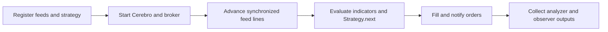
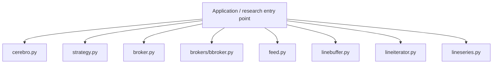
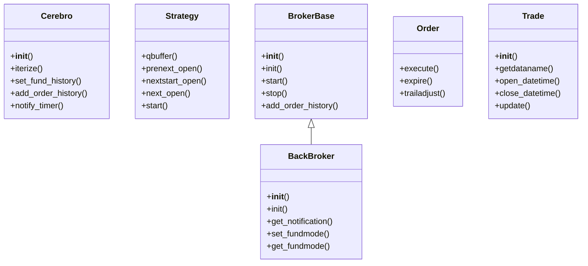
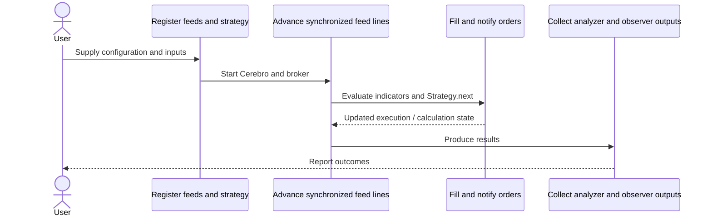
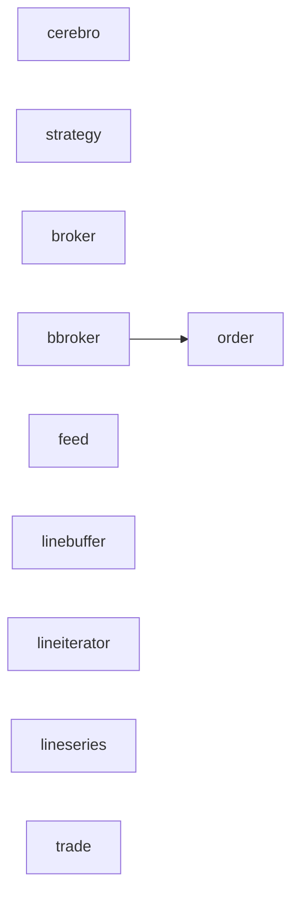
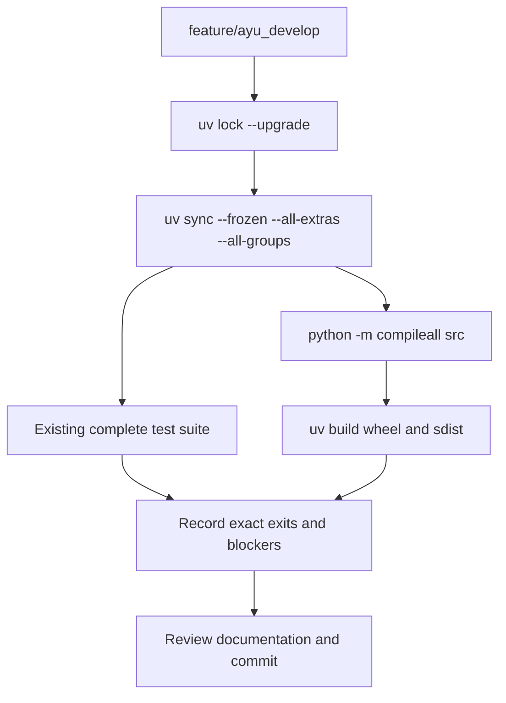

# backtrader: development, architecture and operations

Updated 2026-10-12 on `feature/ayu_develop`; source snapshot `6b671389478f`. This guide follows the source in this checkout and separates available interfaces from verification evidence.

## Purpose and feature boundaries

An event-driven backtesting and live-trading framework organized around Cerebro, line-series data, Strategy, brokers, orders, indicators, analyzers and observers.

Line buffers and metaclasses support composable indicators and multiple feeds. Cerebro owns scheduling and notification; the broker owns cash, commissions and fills. Strategy code communicates through orders rather than mutating broker state. Analyzers summarize execution, while observers and plotting consume results.

## Main workflow

The following is the repository-specific logical workflow. Runtime execution details remain in the linked source and the validation record.

1. Register feeds and strategy.
2. Start Cerebro and broker.
3. Advance synchronized feed lines.
4. Evaluate indicators and Strategy.next.
5. Fill and notify orders.
6. Collect analyzer and observer outputs.

## Components and ownership

The entry point composes the source modules below; arrows indicate review/navigation boundaries rather than a claim that every module is called in every run.

| Source | Declared classes / functions | Implementation role |
|---|---|---|
| [src/backtrader/cerebro.py](../src/backtrader/cerebro.py) | OptReturn, Cerebro | See the public declarations and implementation linked here. |
| [src/backtrader/strategy.py](../src/backtrader/strategy.py) | MetaStrategy, Strategy, MetaSigStrategy, SignalStrategy | See the public declarations and implementation linked here. |
| [src/backtrader/broker.py](../src/backtrader/broker.py) | MetaBroker, BrokerBase | See the public declarations and implementation linked here. |
| [src/backtrader/brokers/bbroker.py](../src/backtrader/brokers/bbroker.py) | BackBroker | See the public declarations and implementation linked here. |
| [src/backtrader/feed.py](../src/backtrader/feed.py) | MetaAbstractDataBase, AbstractDataBase, DataBase, FeedBase, MetaCSVDataBase, CSVDataBase | See the public declarations and implementation linked here. |
| [src/backtrader/linebuffer.py](../src/backtrader/linebuffer.py) | LineBuffer, MetaLineActions, PseudoArray, LineActions, _LineDelay, _LineForward; LineDelay, LineNum | .. module:: linebuffer |
| [src/backtrader/lineiterator.py](../src/backtrader/lineiterator.py) | MetaLineIterator, LineIterator, DataAccessor, IndicatorBase, ObserverBase, StrategyBase; LinesCoupler | See the public declarations and implementation linked here. |
| [src/backtrader/lineseries.py](../src/backtrader/lineseries.py) | LineAlias, Lines, MetaLineSeries, LineSeries, LineSeriesStub; LineSeriesMaker | .. module:: lineroot |
| [src/backtrader/order.py](../src/backtrader/order.py) | OrderExecutionBit, OrderData, OrderBase, Order, BuyOrder, StopBuyOrder | See the public declarations and implementation linked here. |
| [src/backtrader/trade.py](../src/backtrader/trade.py) | TradeHistory, Trade | See the public declarations and implementation linked here. |
| [src/backtrader/analyzer.py](../src/backtrader/analyzer.py) | MetaAnalyzer, Analyzer, MetaTimeFrameAnalyzerBase, TimeFrameAnalyzerBase | See the public declarations and implementation linked here. |
| [src/backtrader/observer.py](../src/backtrader/observer.py) | MetaObserver, Observer | See the public declarations and implementation linked here. |
| [src/backtrader/sizer.py](../src/backtrader/sizer.py) | Sizer | See the public declarations and implementation linked here. |
| [src/backtrader/feeds/pandafeed.py](../src/backtrader/feeds/pandafeed.py) | PandasDirectData, PandasData | See the public declarations and implementation linked here. |

## Class design

Methods and inheritance edges are taken from the selected declarations in the actual source. A missing edge means composition or an external base is not asserted here.

## End-to-end interaction

This sequence presents the responsibilities of the main workflow, including the state/result boundary. The linked classes and functions provide the exact method-level contract.

## Source dependency direction

These edges are actual explicit imports between the selected source modules. Dynamic imports, re-exports and third-party internals are omitted.

## Design details and extension points

### `Cerebro`

Source: [src/backtrader/cerebro.py](../src/backtrader/cerebro.py).

Params:

- `iterize`: Handy function which turns things into things that can be iterated upon including iterables
- `set_fund_history`: Add a history of orders to be directly executed in the broker for performance evaluation
- `add_order_history`: Add a history of orders to be directly executed in the broker for performance evaluation
- `notify_timer`: Receives a timer notification where ``timer`` is the timer which was returned by ``add_timer``, and ``when`` is the calling time. ``args`` and ``kwargs`` are any additional arguments passed to ``add_timer``
- `add_timer`: Schedules a timer to invoke ``notify_timer``

### `Strategy`

Source: [src/backtrader/strategy.py](../src/backtrader/strategy.py).

Base class to be subclassed for user defined strategies.

- `qbuffer`: Enable the memory saving schemes. Possible values for ``savemem``:
- `prenext_open`: See implementation for the complete contract.
- `nextstart_open`: See implementation for the complete contract.
- `next_open`: See implementation for the complete contract.
- `start`: Called right before the backtesting is about to be started.

### `BrokerBase`

Source: [src/backtrader/broker.py](../src/backtrader/broker.py).

The class contract is defined by its linked implementation.

- `init`: See implementation for the complete contract.
- `start`: See implementation for the complete contract.
- `stop`: See implementation for the complete contract.
- `add_order_history`: Add order history. See cerebro for details
- `set_fund_history`: Add fund history. See cerebro for details

### `BackBroker`

Source: [src/backtrader/brokers/bbroker.py](../src/backtrader/brokers/bbroker.py).

Broker Simulator

- `init`: See implementation for the complete contract.
- `get_notification`: See implementation for the complete contract.
- `set_fundmode`: Set the actual fundmode (True or False)
- `get_fundmode`: Returns the actual fundmode (True or False)
- `set_fundstartval`: Set the starting value of the fund-like performance tracker

### `Order`

Source: [src/backtrader/order.py](../src/backtrader/order.py).

Class which holds creation/execution data and type of oder.

- `execute`: See implementation for the complete contract.
- `expire`: See implementation for the complete contract.
- `trailadjust`: See implementation for the complete contract.

### `Trade`

Source: [src/backtrader/trade.py](../src/backtrader/trade.py).

Keeps track of the life of an trade: size, price,
commission (and value?)

- `getdataname`: Shortcut to retrieve the name of the data this trade references
- `open_datetime`: Returns a datetime.datetime object with the datetime in which the trade was opened
- `close_datetime`: Returns a datetime.datetime object with the datetime in which the trade was closed
- `update`: Updates the current trade. The logic does not check if the trade is reversed, which is not conceptually supported by the object.

## Repository layout and resources

Installable packages live under `src/`. `pyproject.toml` defines package metadata, build requirements, optional integrations and development dependencies; `uv.lock` records resolved versions, and `.python-version` selects the local interpreter. This layout keeps an accidental checkout import from substituting for the installed wheel. Package resources remain beside their owning modules and are included by the build backend. Existing upstream examples, fixtures, scripts and documentation retain their separate roles.

## Maintenance compatibility and evidence

- Python 3.15 installs, compiles, builds and passes the complete supplied function-based pytest suite.
- UTC constructors now use timezone-aware UTC and remove tzinfo to preserve the established naive-UTC public return convention.
- pytest python_classes=[] avoids collecting constructor-bearing simulation helper classes; all 82 supplied test functions are still collected.

## Development and verification workflow

See [development commands](development.md) and [validation evidence](validation.md) for interpreter selection, dependency exceptions, full-suite results and remaining blockers. No additional test cases were introduced by this maintenance.
